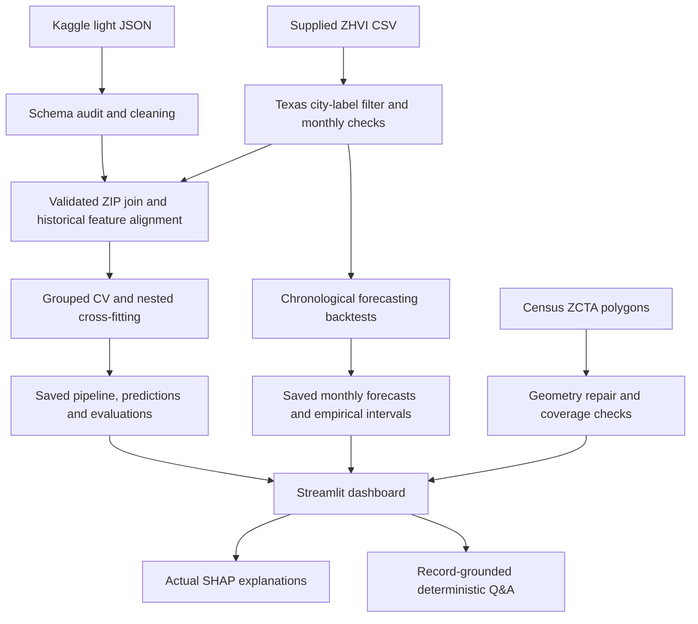

# Architecture

Training and serving are separate. Only the offline pipeline reads raw files and performs model fits. The application loads compact saved artifacts with caching and uses the trusted selected pipeline for SHAP. No large downloads, paid API or retraining occurs on app startup. Source acquisition, model choice, partitions and metrics are recorded in artifacts/evaluation.
