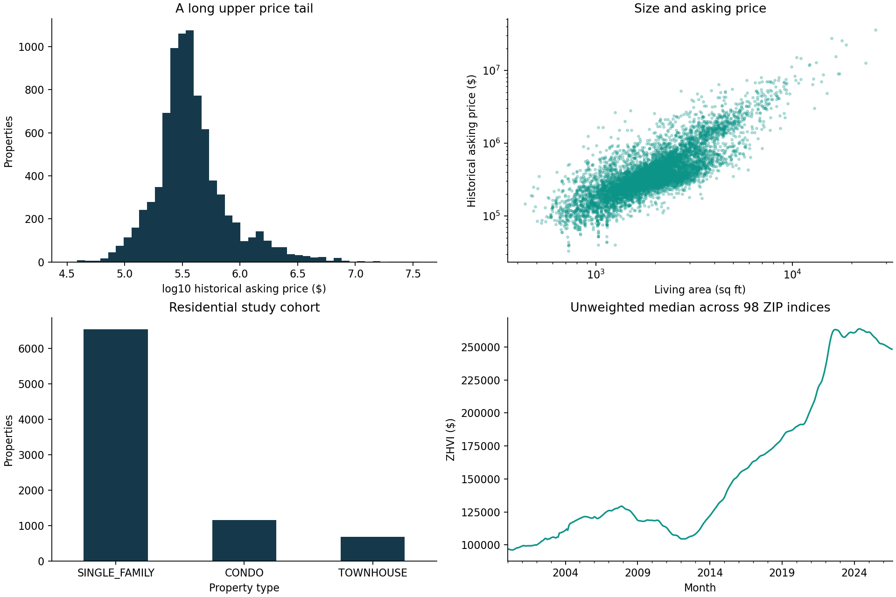
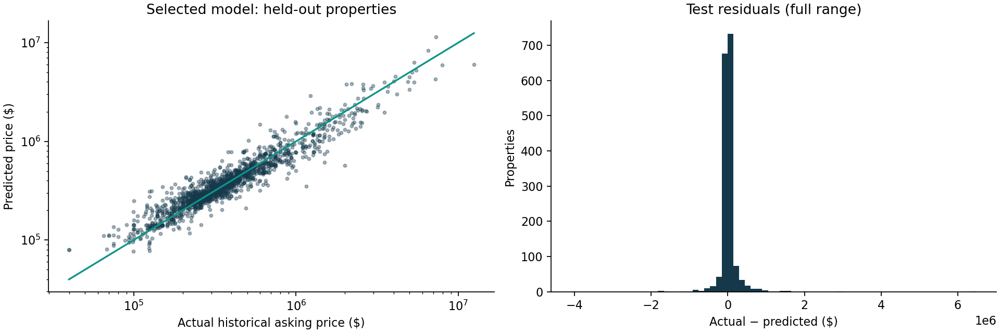

# Exploratory analysis

The clean residential cohort contains 8,376 historical examples. Median asking price is $345,900; the middle half spans $250,000–$507,990. Maximum $36,000,000 indicates a strong upper tail. No percentile trimming was applied to hide difficult expensive examples. Log-target modeling addresses scale but does not remove outliers.

Spearman associations with price: living area 0.767; bedrooms 0.459; bathrooms 0.675. Associations are not causal effects. Missing lot area is handled inside modeling folds; no year-built distribution is available in this file. City filtering excludes broader-metro listings rather than silently expanding scope.

Latest year-over-year ZIP ZHVI changes: median -1.86%, minimum -9.77%, maximum +11.11%. These are ZIP-level modeled values, not realized property returns. The plotted median across ZIPs is an unweighted summary, not an official citywide Zillow index.

ZIP-level listing counts/median prices, missingness, coordinate coverage and model errors are available in the dashboard and saved audit tables. Geographic validation independently reports ZIP/ZCTA mismatches and excludes outside-region map points.

